# Dokumentasi Alur Pengolahan Data Dasbor Gizi NTT 2045

Riset PRIS RUPA Future Society 2026, FKM UI dan OR IPSH BRIN. Pengelola data: R. Sutiawan.
Versi 0.1, 19 November 2026. Dokumen kerja tim; diperbarui bersama kode.

Dokumen ini menjelaskan logika pengolahan data di balik setiap menu dasbor: dari mana data berasal, langkah olahnya, metode yang dipakai, dan hasil yang tampil. Mockup dasbor saat ini memakai angka ilustrasi; alur di bawah adalah rancangan untuk dasbor riset.

Tanda yang dipakai:

- **[KEPUTUSAN TIM]**: pilihan teknis yang belum diputuskan dan perlu disepakati tim.
- **[VERIFIKASI]**: sumber atau definisi perlu dicek ke penyedia data atau kamus variabel.

## Daftar isi

0. [Alur umum](#0-alur-umum)
1. [Menu 1 Ringkasan](#menu-1-ringkasan)
2. [Menu 2 Peta dan lintasan](#menu-2-peta-dan-lintasan)
3. [Menu 3 Kelompok kabupaten](#menu-3-kelompok-kabupaten)
4. [Menu 4 Skenario 2045](#menu-4-skenario-2045)
5. [Menu 5 Suara warga](#menu-5-suara-warga)
6. [Menu 6 Metadata](#menu-6-metadata)
7. [Pemutakhiran tahunan](#7-pemutakhiran-tahunan)
8. [Rujukan metode](#8-rujukan-metode)

---

## 0. Alur umum

Semua menu dibangun dari satu rangkaian skrip R yang dijalankan dengan paket `targets`. Satu perintah (`targets::tar_make()`) menjalankan ulang seluruh tahap, dan hanya tahap yang inputnya berubah yang dihitung ulang.

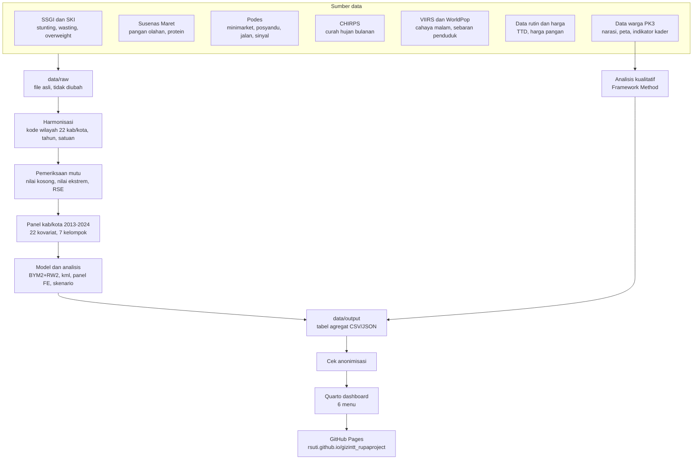

| Tahap | Isi | Folder atau berkas |
|---|---|---|
| Data mentah | File asli dari penyedia, disimpan apa adanya | `data/raw/` (tidak diunggah ke repositori publik) |
| Harmonisasi | Kode wilayah BPS, penyesuaian pemekaran, satuan | `R/01_harmonisasi.R` |
| Panel | Satu baris per kab/kota per tahun | `data/panel/panel_ntt_2013_2024.csv` |
| Model | Skrip per metode | `R/02_bym2.R`, `R/03_kml.R`, `R/04_panel_fe.R`, `R/05_skenario.R` |
| Keluaran | Hanya angka agregat | `data/output/` |
| Dasbor | Halaman Quarto | `dasbor/index.qmd` |

Nama berkas dan folder di atas adalah usulan struktur [KEPUTUSAN TIM].

---

## Menu 1 Ringkasan

Menampilkan nilai provinsi tahun terpilih, perubahan dari tahun sebelumnya, tren singkat, status warna, dan kotak skenario tempat NTT berada.

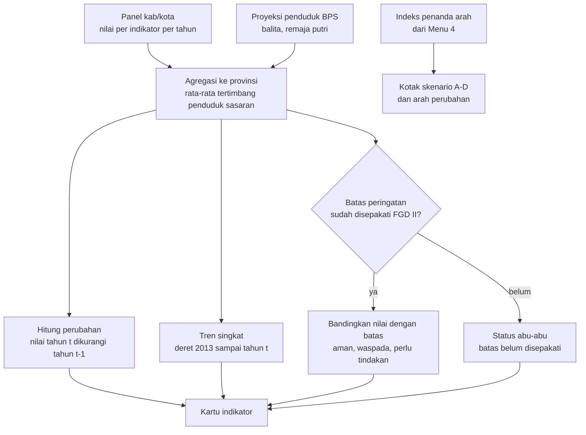

| Unsur | Logika |
|---|---|
| Nilai provinsi | Rata-rata kab/kota ditimbang jumlah penduduk sasaran (balita untuk stunting dan wasting; remaja putri untuk TTD; rumah tangga untuk indikator Susenas). Untuk indikator survei gizi, dipakai angka provinsi resmi bila tersedia. |
| Arah baik/buruk | Tiap indikator punya arah "buruk bila naik" (misalnya stunting) atau "buruk bila turun" (misalnya protein, posyandu, TTD). Warna teks perubahan mengikuti arah ini. |
| Status warna | Hanya aktif bila batas peringatan sudah ditetapkan di FGD II (Mei 2027). Sebelum itu tampil "batas belum disepakati". |
| Anemia | Hanya data konteks (SKI, sekitar 5 tahunan, tingkat provinsi); tidak dipakai untuk pemantauan tahunan. |

---

## Menu 2 Peta dan lintasan

Menampilkan peta 22 kab/kota untuk indikator terpilih dan lintasan satu kabupaten dari 2013 beserta rentang ketidakpastian. Cara olah berbeda menurut jenis sumber data.

### 2a. Indikator survei gizi (stunting, wasting)

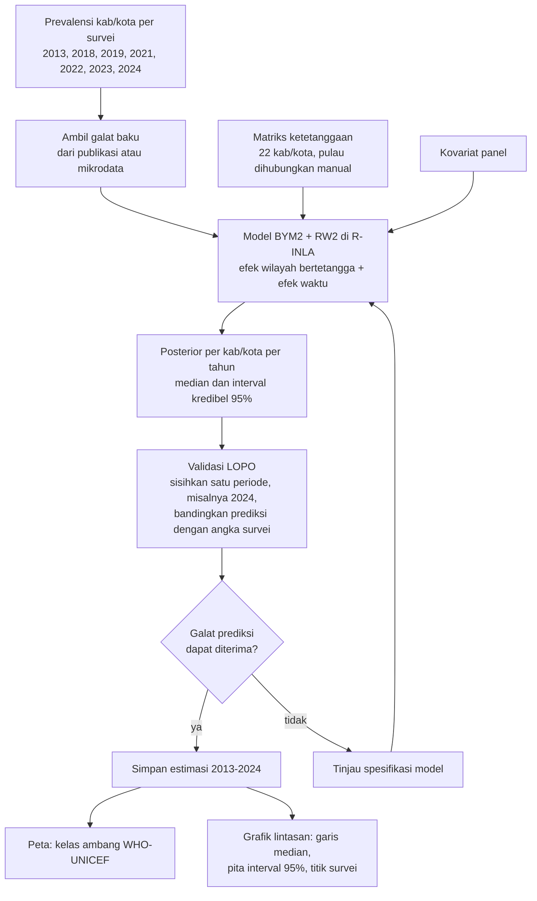

### 2b. Indikator Susenas (pangan olahan, protein)

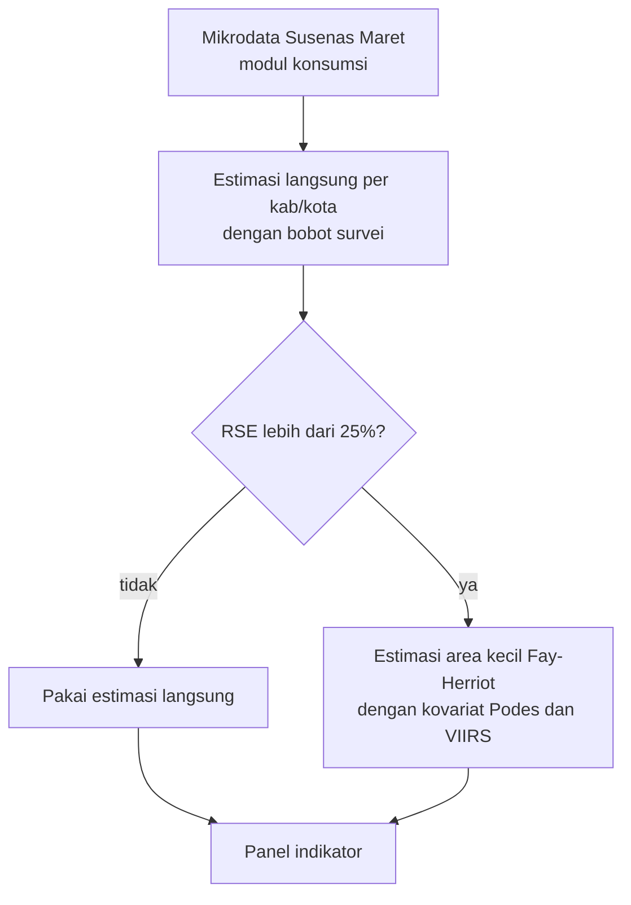

### 2c. Indikator big data dan Podes

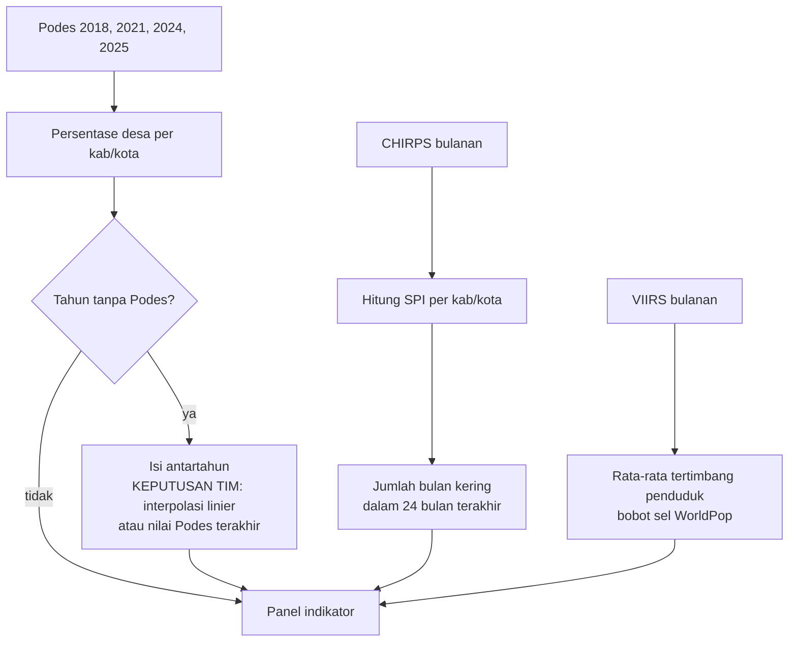

| Unsur | Logika |
|---|---|
| Kelas warna peta, stunting dan wasting | Lima kelas ambang prevalensi WHO-UNICEF (de Onis dkk., 2019). Stunting: kurang dari 2,5; 2,5 sampai kurang dari 10; 10 sampai kurang dari 20; 20 sampai kurang dari 30; 30% atau lebih. Wasting: kurang dari 2,5; 2,5 sampai kurang dari 5; 5 sampai kurang dari 10; 10 sampai kurang dari 15; 15% atau lebih. |
| Kelas warna peta, indikator lain | Kuintil antarkabupaten pada tahun terpilih. Hijau selalu kondisi terbaik; untuk indikator "buruk bila turun", urutan warna dibalik. |
| Penimbang VIIRS | Cahaya malam di sel tanpa penduduk tidak ikut dihitung; tiap sel diberi bobot jumlah penduduk WorldPop agar nilai kab/kota mewakili tempat orang tinggal. |
| Overweight balita | Angka kab/kota kurang teliti (SKI 2023: RSE di atas 25% di sebagian besar kab/kota), sehingga hanya ditampilkan di tingkat provinsi. |
| Harga pangan | Komoditas dan ketersediaan per kab/kota NTT [VERIFIKASI]. |
| Cakupan TTD | Sumber dan definisi laporan rutin Dinkes [VERIFIKASI]. |

---

## Menu 3 Kelompok kabupaten

Mengelompokkan kabupaten yang lintasan stuntingnya mirip, lalu menjelaskan faktor yang membedakan kelompok dan kaitannya dengan skenario.

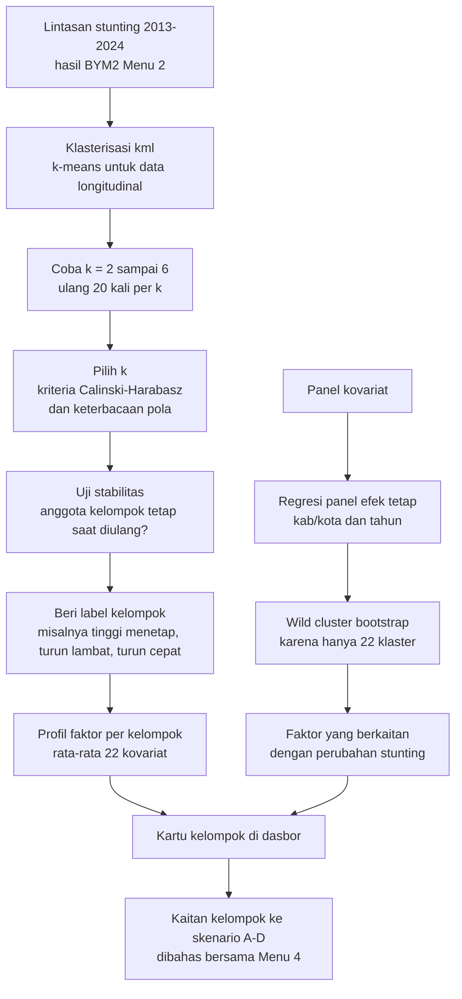

| Unsur | Logika |
|---|---|
| Input klasterisasi | Lintasan hasil model (bukan angka survei mentah), agar tahun tanpa survei sudah terisi dan galat sampling diredam. |
| Jumlah kelompok | Dipilih dari kriteria statistik dan kemudahan dibaca pengguna; jumlah final [KEPUTUSAN TIM]. |
| Wild cluster bootstrap | Galat baku biasa terlalu optimistis bila klaster hanya 22; bootstrap memberi interval yang lebih jujur. |
| Batas tafsir | Hubungan faktor dengan stunting bersifat asosiasi, bukan sebab-akibat. |

---

## Menu 4 Skenario 2045

Menampilkan matriks empat skenario, posisi NTT (atau satu kabupaten) dari tahun ke tahun, penanda arah, dan rentang proyeksi stunting per skenario.

### 4a. Penyusunan skenario (sekali, awal 2027)

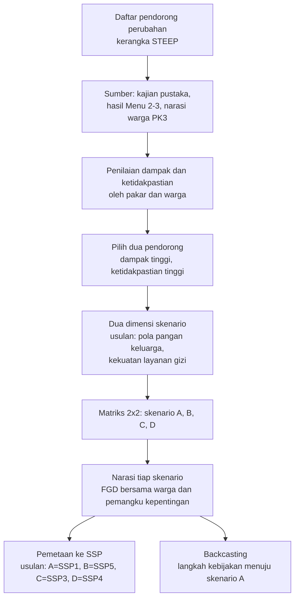

### 4b. Posisi tahunan dan proyeksi

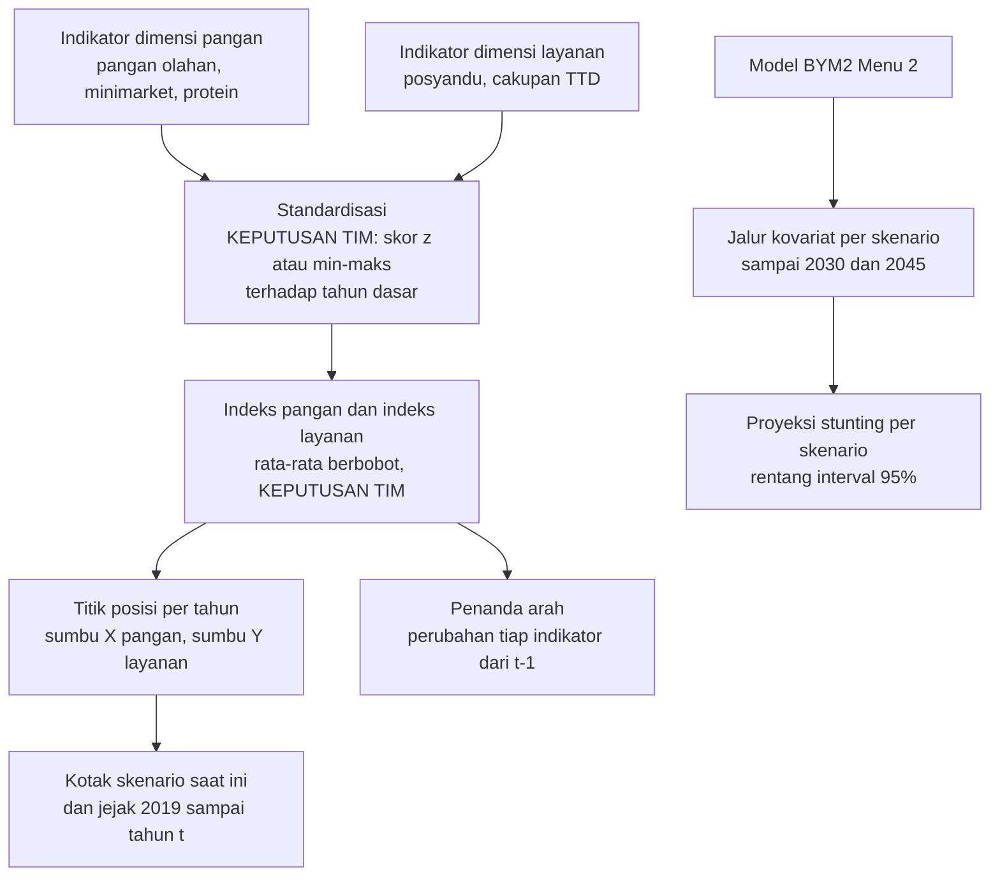

| Unsur | Logika |
|---|---|
| Arah penanda | Pangan olahan dan minimarket naik berarti bergeser ke pangan olahan; protein turun juga dibaca bergeser ke pangan olahan. Posyandu dan TTD naik berarti layanan menguat. Bulan kering dibaca sebagai tekanan iklim, tidak masuk dua dimensi. |
| Rumus indeks | Rumus di mockup hanya ilustrasi. Indikator, bobot, dan cara standardisasi ditetapkan tim [KEPUTUSAN TIM]. |
| Proyeksi | Ditampilkan sebagai rentang, bukan satu angka. Skenario bukan ramalan; gunanya menguji kebijakan mana yang tetap berhasil di keempat kemungkinan. |

---

## Menu 5 Suara warga

Menampilkan hasil komponen warga (PK3) dari 6 desa di 3 lokasi gradien urbanisasi: TTS, Kabupaten Kupang, Kota Kupang.

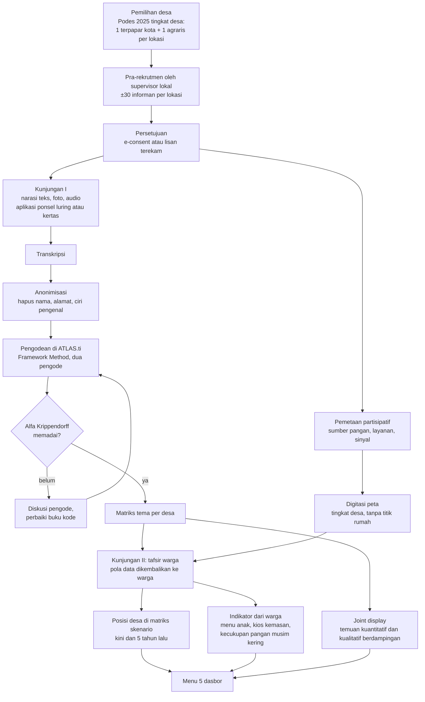

| Unsur | Logika |
|---|---|
| Kesepakatan pengode | Target alfa Krippendorff sekurang-kurangnya 0,80; nilai 0,667 sampai 0,80 hanya untuk kesimpulan sementara (Krippendorff, 2004). |
| Kutipan | Hanya kutipan yang sudah dianonimkan dan disetujui tampil; label informan hanya peran (misalnya ibu balita, kader). |
| Tingkat lokasi | Paling rinci desa. Tidak ada koordinat rumah atau nama informan (UU 27/2022 dan protokol etik). |
| Indikator warga | Dikumpulkan kader per semester atau tahunan; instrumen disusun dari hasil PK3 dan diuji pada Kunjungan II. |

---

## Menu 6 Metadata

Menampilkan definisi, sumber, tingkat, frekuensi, dimensi skenario, dan batas peringatan tiap indikator, serta menyediakan data agregat.

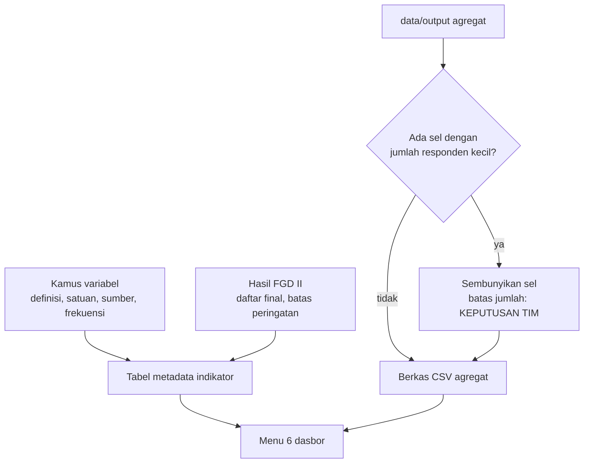

---

## 7. Pemutakhiran tahunan

Alur yang dijalankan Bapperida atau tim setiap kali data baru terbit.

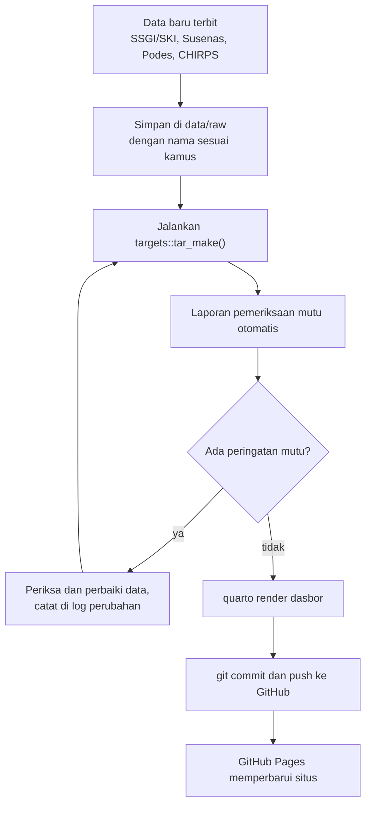

| Frekuensi | Sumber |
|---|---|
| Bulanan | CHIRPS, VIIRS |
| Tahunan | SSGI/SKI, Susenas, data rutin TTD, indikator warga tahunan |
| Sekitar 3 tahunan | Podes |
| Sekitar 5 tahunan | Anemia (SKI), hanya konteks |

---

## 8. Rujukan metode

- Cameron, A. C., Gelbach, J. B., & Miller, D. L. (2008). Bootstrap-based improvements for inference with clustered errors. *The Review of Economics and Statistics, 90*(3), 414–427.
- de Onis, M., dkk. (2019). Prevalence thresholds for wasting, overweight and stunting in children under 5 years. *Public Health Nutrition, 22*(1), 175–179.
- Fay, R. E., & Herriot, R. A. (1979). Estimates of income for small places: An application of James-Stein procedures to census data. *Journal of the American Statistical Association, 74*(366), 269–277.
- Gale, N. K., Heath, G., Cameron, E., Rashid, S., & Redwood, S. (2013). Using the framework method for the analysis of qualitative data in multi-disciplinary health research. *BMC Medical Research Methodology, 13*, 117.
- Genolini, C., & Falissard, B. (2010). KmL: k-means for longitudinal data. *Computational Statistics, 25*(2), 317–328.
- Krippendorff, K. (2004). *Content analysis: An introduction to its methodology* (2nd ed.). Sage.
- Riebler, A., Sørbye, S. H., Simpson, D., & Rue, H. (2016). An intuitive Bayesian spatial model for disease mapping that accounts for scaling. *Statistical Methods in Medical Research, 25*(4), 1145–1165.

Rujukan lain (SSP, CIOMS, BPS, WorldPop, CHIRPS, VIIRS) ada di daftar pustaka kerja proyek.
